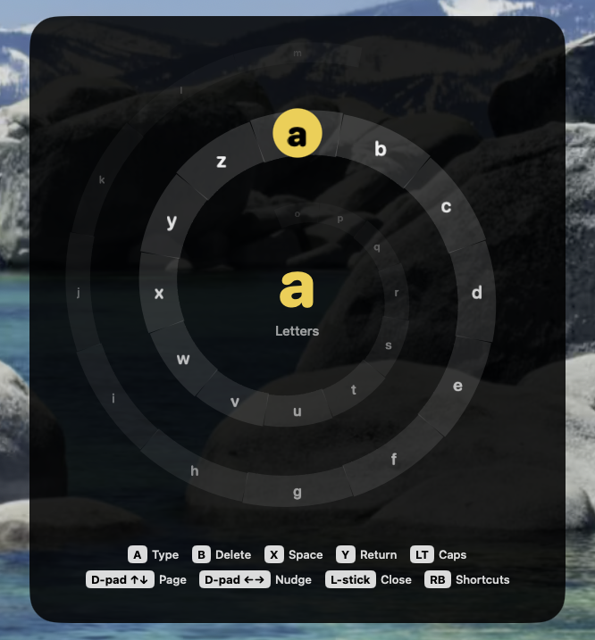

# MacMyController

Use a game controller as a mouse and keyboard on your Mac, and have it get out of the way when a game or app handles the controller itself.

MacMyController is a small, native menu-bar app for couch computing. Pick up an Xbox controller and you can point, click, scroll, type with a spiral keyboard and fire common shortcuts. Open GeForce NOW (or any app you choose) and it stops sending anything, so the controller works there exactly as normal.

It's deliberately simple: sensible fixed controls that work out of the box, not a button-mapping editor.

<p align="center">
  
</p>

> Inspired by [Controller Companion](https://store.steampowered.com/app/367670/Controller_Companion/) on Windows. MacMyController is an independent implementation for macOS.

## Features

- **Desktop controls**: smooth pointer with a precision mode, two-axis scrolling, click, double-click and drag.
- **Spiral keyboard**: point the stick at a letter and press A. Letters wind around an endless coil that scrolls with you, so there are no dead ends.
- **Shortcut wheel**: hold RB, aim and press A for Spotlight, Copy, Paste, Cut, Undo, Select All, Close Window or Previous App.
- **Automatic handoff**: apps that handle controllers themselves get the controller untouched. GeForce NOW is recognised out of the box, and you can set any other app from the menu bar.
- **Safe by design**: nothing is sent while you're in a handed-off app, while the Mac sleeps or after the controller disconnects. Held clicks and keys are always released, and controls wait for you to let go of the controller before starting again.
- **Native and light**: Swift, AppKit and SwiftUI with no dependencies. It does no work while the controller is idle.

## Controls

| Control                | Desktop                   | Spiral keyboard                |
| ---------------------- | ------------------------- | ------------------------------ |
| Left stick             | Move the pointer          | Point at a character           |
| Left trigger (hold)    | Slow, precise pointer     | Capitals                       |
| Right stick            | Scroll                    |                                |
| A                      | Left click (hold to drag) | Type the highlighted character |
| B                      | Right click               | Delete (repeats while held)    |
| X                      | Escape                    | Space                          |
| Y                      | Return                    | Return                         |
| D-pad                  | Arrow keys                | ↑↓ change page, ←→ nudge       |
| Left stick click       | Open the keyboard         | Close the keyboard             |
| RB (hold)              | Shortcut wheel            | Shortcut wheel                 |
| View + Menu (hold 1 s) | Pause or resume           | Pause or resume                |

### Spiral keyboard

Push the left stick in any direction, including diagonals, to select the character in that direction. There are 12 characters per lap. Keep winding round to move onto the next lap; the coil is endless, so `z` leads straight on to `a`. The lap you're on sits on the bright middle ring, with what's coming next winding outwards and what you've passed winding inwards.

Pages cover lowercase letters, numbers and common symbols. The keyboard floats over everything and never takes focus, so text goes into the app you were already using. It types directly; it never touches the clipboard.

### Shortcut wheel

Hold RB, aim the left stick, press A. Releasing RB without pressing A cancels, and a centred stick runs nothing. Each hold runs at most one shortcut. Letter shortcuts assume a US key layout.

## Handing the controller to games

macOS doesn't tell other apps whether a game is using the controller, so MacMyController works from a short list of known apps plus your choices:

- **Automatic**: GeForce NOW (the app and its streamer) gets the controller. Everything else gets desktop controls.
- **Always**: from the menu bar icon, choose *Always Use Desktop Controls* or *Always Hand Controller to …* for the app in front. Saved choices are listed in Settings.
- **For now**: a temporary choice for the current app that ends when you switch apps.

Handing off never captures or hides the controller. MacMyController simply stops sending mouse and keyboard events.

## Settings

Open **Settings…** from the menu bar icon to adjust pointer speed, scroll speed and keyboard size, turn on **Open at login**, and review or forget saved app choices.

## Requirements

- macOS 14 or later, Apple silicon or Intel.
- A controller that macOS supports through the Game Controller framework. Developed and tested with an Xbox Wireless Controller over Bluetooth. Other controllers may work but haven't been tested.
- Accessibility permission, so the app can move the pointer and type.

## Build and run

There are no prebuilt releases yet. With Xcode or the Xcode command line tools installed:

```sh
git clone https://github.com/reefbarman/macmycontroller.git
cd macmycontroller
swift test                  # unit tests
./scripts/build-app.sh      # builds build/MacMyController.app
open build/MacMyController.app
```

On first launch, allow MacMyController under **System Settings → Privacy & Security → Accessibility** (called **Device Control and Data Access** on macOS 27). The status window shows when it's ready. Run the `.app` rather than `swift run`, because macOS ties the permission and background controller input to the app bundle.

`build-app.sh` uses an Apple Development or Developer ID certificate if you have one, or set `SIGN_IDENTITY`. Without one it signs the app locally so the permission survives rebuilds on your own Mac. Builds signed that way aren't suitable for sharing.

## Privacy

MacMyController reads the controller and which app is in front, and sends mouse and keyboard events. That's all. It doesn't read other apps' text, record what you type, use the network or collect anything. Settings stay in local preferences.

## How it's built

```
Sources/MacMyControllerCore/   Pure, unit-tested logic: stick maths, handoff rules,
                               desktop mapper, spiral keyboard, shortcut wheel, router
Sources/MacMyController/       The app: GameController input, front-app tracking,
                               CGEvent output, menu bar, overlay and settings windows
Tests/                         XCTest suite for the core
plans/                         Design notes and roadmap
```

All controller handling runs on the main thread through one router, so a mode change and the next event can never race. Overlays are click-through, non-activating panels.

## Status and roadmap

Working day to day on the author's Macs. Next up:

- Testing on a TV setup with GeForce NOW streaming
- An experimental swipe-typing keyboard to compare against the spiral
- Prebuilt, notarised releases

Issues and suggestions are welcome.

## Licence

MIT. See [LICENSE](LICENSE).
