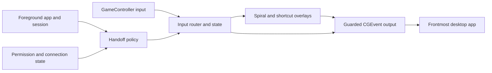

# MacMyController: a simple controller companion for macOS

Status: proposed for review. No application code exists yet.

## Recommendation

Build a small native menu-bar app with useful fixed controls, a spiral keyboard and a compact shortcut wheel. Start with Tristan's Xbox Wireless Controller and M4 Mac mini. Stop generating mouse and keyboard events when a recognised controller-native app becomes active; do not intercept or replace its real controller input.

Make the spiral the first complete typing experience. Prototype stick-driven swipe typing afterwards and keep it only if it is genuinely easier from the sofa. Do not build a general remapping, macro or scripting product.

## Starting point and target

- This workspace contains no existing app, Git repository, build pipeline or delivery convention. There is nothing to migrate. Do not publish it or invent a remote as part of planning.
- The sibling `../homeassistant/macmini/README.md` identifies the living-room M4 Mac mini, paired Xbox Wireless Controller and GeForce NOW setup. It describes macOS 27; the exact installed version has not been checked live.
- That setup already launches GeForce NOW when the controller connects. Leave its Home Assistant automation, voice services, power settings and controller watcher unchanged.
- Local development host: macOS 26.7.1, Xcode present, Swift 6.4, Apple Silicon. The read-only toolchain checks passed, with Xcode filesystem-event warnings in the sandbox.
- Initial supported/tested target: the actual Xbox controller over Bluetooth on the M4 mini. Use macOS 14 as the deployment baseline for the chosen public APIs, without promising older-OS or other-controller compatibility before testing.
- GeForce NOW is the first handoff target, inferred from the existing setup. Add a local native game to validation when one is available.

## What competitor research changes

These are documentation findings, not hands-on usability results.

| Reference                                                                                                 | Relevant behaviour                                                                                                                                   | Decision for this app                                                                                                                              |
| --------------------------------------------------------------------------------------------------------- | ---------------------------------------------------------------------------------------------------------------------------------------------------- | -------------------------------------------------------------------------------------------------------------------------------------------------- |
| [Controller Companion](https://store.steampowered.com/app/367670/Controller_Companion/)                   | Left stick points, right stick scrolls, stick-click opens a spiral keyboard. Its documented auto-disable uses fullscreen programs, with an override. | Keep the simple desktop model and spiral inspiration, but do not treat fullscreen as proof of controller support.                                  |
| [Controlly](https://apps.apple.com/us/app/controlly/id1548544614?mt=12)                                   | Native Mac controller remote with pointer, scrolling, system actions and shortcuts.                                                                  | Native Mac integration and a small useful action set are enough; a mapping editor is not the product.                                              |
| [ControllerKeys](https://github.com/NSEvent/xbox-controller-mapper/blob/main/README.md)                   | Documents an on-screen keyboard with SHARK2 swipe recognition, D-pad navigation and per-app profiles, alongside many automation features.            | Swipe is feasible enough to prototype, but its advertised presence does not demonstrate Xbox-stick accuracy. Avoid its much broader feature scope. |
| [Steam's historical Daisywheel](https://www.engadget.com/2012-09-11-steam-big-picture-beta-hands-on.html) | Eight directional groups, with four face-button choices within a group. This is a historical design reference, not a claim about current Steam.      | Useful fallback to compare if rotary selection feels slow. Large directional targets may suit Xbox better than drawing precise paths.              |

ControllerKeys is source-available under a noncommercial licence according to its [publisher](https://www.kevintang.xyz/apps/controller-keys/). Use it as research, not as a code or asset dependency. Create our own keyboard design and implementation. Review licences before adding any dictionary, recognition library or borrowed assets.

## First-run experience and controls

Pair the controller through macOS, open the app, grant its computer-control permission, and see a short controller diagram. No profile creation. The menu-bar icon explains the current state: Desktop, Native controller, Paused, Controller disconnected or Permission required.

Proposed defaults, to tune with the real controller:

| Control                        | Desktop                         | Spiral keyboard                                                          |
| ------------------------------ | ------------------------------- | ------------------------------------------------------------------------ |
| Left stick                     | Pointer movement                | Rotate through letters                                                   |
| Right stick                    | Vertical/horizontal scroll      | Unassigned initially                                                     |
| A                              | Left mouse button; hold to drag | Insert highlighted character                                             |
| B                              | Right mouse button              | Backspace, with deliberate repeat                                        |
| X                              | Escape                          | Space                                                                    |
| Y                              | Return                          | Return, only on an explicit press                                        |
| D-pad                          | Arrow keys                      | Left/right move one character; up/down switch letter/number/symbol pages |
| Left trigger                   | Hold for precision pointing     | Hold for uppercase; no sticky modifier                                   |
| Left stick click               | Open keyboard                   | Close keyboard                                                           |
| Right bumper, held             | Show shortcut wheel             | Temporarily show shortcut wheel                                          |
| View + Menu, held for 1 second | Pause/resume desktop mapping    | Pause and close overlay                                                  |

Unassigned inputs stay unassigned. The Xbox/Guide button is not required because macOS or Steam may reserve it. Labels use Xbox glyphs initially.

The pause chord is recognised before ordinary actions and must be released before another mode starts. It does not enable mappings inside native apps by default: games also receive physical controller buttons, so a supposedly invisible global chord would be misleading. Native-mode overrides are available in the menu bar; an optional controller override can be added only after conflict testing on the actual setup.

### Pointer feel

Use a radial dead zone and rescale the remaining stick range, with a nonlinear speed curve and left-trigger precision mode. Movement is elapsed-time-based, not callback-count-based; normalise diagonal speed. Start with approximately 0.15 dead zone and tune against actual drift. Respect the full display coordinate space, including negative display origins and display removal. Double-clicks and drag events must behave like real mouse operations, not a series of unrelated clicks. Stop movement work at neutral rather than spinning continuously.

### Common shortcuts, not a mapping editor

Hold RB to show eight large labelled choices. Aim with the left stick and press A to execute; releasing RB without confirmation cancels. Require a fresh A press and neutral stick on entry so an existing hold cannot fire a command. Each open can execute at most one command.

Initial choices: Spotlight (Command-Space), previous app (Command-Tab), Copy, Paste, Cut, Undo, Select All, and Close Window (Command-W). Labels explain what will happen. Close Window needs the same explicit confirmation as other choices; exclude Quit, Force Quit, shutdown and arbitrary scripts. Previous app is an atomic Command-Tab, not a misleading promise of a full app picker. Use the active keyboard layout for key equivalents where necessary; system shortcuts can be customised outside the app and are not guaranteed to retain macOS defaults.

Keep settings to launch at login (opt-in), pointer/scroll speed, overlay size, keyboard style when an alternative is ready, and app handoff exceptions. Resetting these must be straightforward.

## Spiral keyboard design

Create a large, high-contrast floating keyboard that does not take focus from the target text field. Show alphabetic characters on a gently curved/spiralling track, with a fixed selection marker, an enlarged selected character and a persistent controller legend. Keep it inside the usable bounds of the target display; do not depend on reading text-field contents or taking screenshots.

Interaction proposal:

1. The first stick deflection establishes an angle without jumping to a different character.
2. Rotating the stick clockwise/counterclockwise advances/reverses along the character track. Start with 12 character steps per revolution, not 26 tiny angular targets or a requirement to hit exact radii.
3. Track unwrapped angle with boundary hysteresis. Returning to centre keeps the selection and resets the angular baseline, so regripping cannot skip letters. Clamp at page ends initially rather than wrapping unexpectedly.
4. A inserts exactly one selected character. Holding A does not repeat. D-pad left/right provides exact one-step corrections with a bounded repeat delay.
5. Separate fixed pages cover lowercase letters, digits and common punctuation. LT uppercases letters only. Display the complete page and selected character; do not reorder characters based on prediction.
6. B backspaces, X inserts space, Y sends Return. Closing the keyboard never submits text. There is no dwell-to-type or autocorrect in the first version.

This is an original rotary/spiral proposal, not a claim to reproduce Controller Companion's undocumented internals exactly. Keep the selector logic separate from the drawing so real user feedback can change the geometry without rewriting input handling.

Do not mirror or record the receiving application's text. For ordinary characters, send Unicode text through synthetic keyboard events; send actual key events for Return, Backspace and shortcuts. Do not use the clipboard as a hidden typing transport. App-specific Unicode handling, keyboard layouts and remote streaming need live validation. Login screens, permission prompts, protected fields and arbitrary IME composition are outside the initial support promise.

## Swipe alternative: a bounded experiment

Xbox has no touchpad, so the useful experiment is a thumbstick-controlled QWERTY pointer. Hold a trigger to begin a word, steer through letters, then release to see up to three candidates. A explicitly commits the selected candidate; B cancels without editing the target. D-pad chooses a candidate. Fall back to literal character selection or the spiral for names, URLs, punctuation and words outside the dictionary.

Recognition runs locally. Begin with a permissively licensed English frequency list and an independently implemented geometric template recogniser: resample paths, compare shape and absolute key positions, then rank using endpoint constraints and frequency. Do not assume macOS exposes the iPhone swipe keyboard as a reusable component. Handle repeated letters and corrections explicitly before promoting the prototype. No cloud service, text history, model training or personal-data collection.

Compare against the spiral on the same small set of real searches, names, URLs and short messages. Record completion time, correction count and which feels easier, without logging entered content in the shipped app. If swipe does not beat the spiral on ordinary words without awkward corrections, leave it experimental. Consider a Daisywheel-style selector instead of turning a weak recogniser into a large ML project. This phase is not a prerequisite for a useful first release.

## Automatic handoff and its limits

Apple provides background controller delivery through [`GCController.shouldMonitorBackgroundEvents`](https://developer.apple.com/documentation/gamecontroller/gccontroller/shouldmonitorbackgroundevents). Research did not identify a documented public API that reports whether another process is currently consuming controller input. Do not advertise universal controller-support detection.

Use a small, explicit policy:

1. Missing permission, disconnected controller, inactive user session or manual pause disables output.
2. A temporary, explicit session override may select Desktop or Native; it expires on external foreground-app change or restart. It never bypasses the safety conditions above.
3. A saved per-app choice selects Auto, Desktop or Native. These are handoff exceptions, not button profiles.
4. Auto uses a bundled list of verified native-controller app identities. Unknown apps use Desktop. Do not infer support merely from fullscreen, app category or linked frameworks.
5. Changes release this app's held synthetic inputs, cancel queued output, dismiss overlays, and wait for the controller to return to neutral before rearming. Pausing can issue necessary releases, but no new actions.

Track external foreground apps with `NSWorkspace` notifications. Keyboard and shortcut panels must be nonactivating, and the app's own settings/menu interactions must not be mistaken for a game exit. Settings or permission dialogs suspend output rather than letting the controller type into them. Maintain the target PID and an input generation number; reject stale commands after any target or mode change. Recheck target/state immediately before posting an event. Global OS delivery cannot be made perfectly atomic with a focus switch, so keep text commits small and never replay a cancelled batch into a new app.

### GeForce NOW first

NVIDIA's [2.0.73 release notes](https://www.nvidia.com/en-us/geforce-now/release-highlights/) explicitly added gamepad navigation to its Windows and macOS app. Consequently, the initial recommendation is Native mode for the entire GeForce NOW app, including its library, rather than fragile launcher-versus-stream detection.

Verify the installed app's bundle identifier and any actually frontmost streaming helper before adding rules. Check the library, queue, streaming window, native overlay and return to desktop. A helper merely running is not evidence that the stream is active. If important library/login screens still need a pointer, use an explicit temporary Desktop override and document the potential for double input. Only design a finer launcher/stream rule after observing a stable distinction.

Native mode means this app stops synthesising desktop actions. It does not manufacture a virtual controller, grab an exclusive HID handle, hide physical input, or change the game's bindings. Other apps can still receive the physical controller. Test whether an unfocused GeForce NOW session continues receiving input before resuming desktop control; if it does, the safe workflow may require stopping/leaving the stream first. Also test with Steam running: a second desktop mapper can create duplicates, which our app cannot reliably suppress.

## Native implementation

Use Swift, SwiftUI for settings and overlay contents, and AppKit for the menu-bar lifecycle and nonactivating `NSPanel`s. Start with one Xcode project, one app target and a unit-test target. Use system frameworks only for the MVP; no Electron, driver, privileged daemon or networking dependency.

Components, as files/services rather than separate packages:

- `ControllerService`: connect/disconnect, select one active controller, normalised button edges and axes. Background monitoring is explicit. Never silently combine two controllers.
- `AppContextMonitor` and `HandoffPolicy`: external foreground identity, session/sleep state, bundled rules and user exceptions. Separate pure policy tests from macOS observers.
- `InputRouter`: serialised state transitions and exclusive Desktop, Keyboard, ShortcutWheel, Native, Paused and Blocked routing. An overlay consumes its controls within our mapper; physical gamepad input remains unaffected.
- `EventEmitter`: sole authority to post CGEvents, pointer coordinate conversion, event ordering, pressed-input ownership, guard checks and cleanup.
- `KeyboardModel` / `SpiralSelector`: pure character-selection model, no application access. Later add a separate `SwipeRecognizer` and reuse text output.
- `OverlayCoordinator`: nonactivating panels, target tracking, display placement and dismissal. No OS focus-stealing workaround.
- `Preferences`: versioned local defaults and bundle-ID overrides. No remote catalogue required.

Use one serial ownership boundary for routing/output state and bridge to the main actor for AppKit. Never queue raw controller callbacks across a mode change without a generation check. Cancel repeat timers on every transition. On disconnect, pause, sleep and normal exit, release only synthetic keys/buttons this app owns. On force-quit or permission revocation, cleanup cannot be guaranteed by software that can no longer run or post; minimise persistent modifiers and document recovery rather than promising otherwise.

## Permissions, privacy and delivery

- Distribute a regular non-sandboxed `.app` initially. Use macOS computer-control/Accessibility authorisation and CGEvent posting preflight as appropriate. The mini's documentation calls the macOS 27 settings pane **Device Control and Data Access**; use OS-appropriate wording.
- Do not request Screen Recording, Automation, microphone, network access or Full Disk Access for these features. Do not add raw keyboard monitoring/event taps. Input Monitoring is not an assumed requirement of GameController plus event posting; verify the exact permission flow on the target OS.
- The app sends only controller-derived actions or explicitly selected text. Do not read other apps' text, collect keystrokes, log typed content or persist swipe traces.
- Keep a stable bundle ID and app path for local tests. Developer ID signing/notarisation and a signing identity are prerequisites for broader distribution, not reasons to disable Gatekeeper. Confirm available signing before promising frictionless installs. Do not claim App Store eligibility.
- Launch at login uses `SMAppService`, is opt-in, and must be removable. Quit is always available in the menu bar. No privileged background component remains after quitting.
- Build/test locally first. Arrange a deliberate mini test session; launching GeForce NOW or waking its screen can affect the living-room TV. Do not deploy, wake it or alter its Home Assistant setup just to inspect this plan.
- Rollback: quit the app, turn off its login item, remove the app if desired and optionally revoke its permission. Normal quitting releases owned input. Native controller behaviour requires no restoration because it was never replaced.

## Build sequence and acceptance gates

### 1. Prove the desktop-to-game loop

Create the app shell, permission onboarding, Xbox discovery, pointer/click/drag/scroll, mode indicator, foreground policy and safe cleanup. Include a small built-in diagnostic view that shows controller state and foreground bundle ID, never typed content.

Gate: a real Xbox moves and clicks on the desktop, stops generating actions when verified GeForce NOW identities become frontmost, and resumes safely after returning to the desktop. Confirm background monitoring does not impair native game input. If this fails, resolve that narrow problem before adding keyboard polish or raw-HID fallbacks.

### 2. Complete the first useful release

Add the spiral keyboard, digits/punctuation, shortcut wheel, useful settings, per-app handoff exceptions and opt-in login launch. Tune the keyboard and pointer at TV viewing distance. Default rules only name apps actually verified, starting with GeForce NOW.

Gate: use the controller to search in a browser, correct text, enter a URL, copy/paste, launch/play/exit a game and return to desktop without stuck modifiers, unintended clicks or the overlay stealing focus. Protected OS dialogs still require normal OS interaction.

### 3. Evaluate an alternative keyboard

Prototype QWERTY swipe and compare with the spiral. If thumbstick precision or recognition makes it worse, retain the spiral and test the directional-group alternative. Do not delay phases 1 and 2 for this experiment.

### Validation checklist

Automated, using Xcode build and the test target:

- [ ] Dead-zone boundaries, diagonal speed and elapsed-time movement.
- [ ] Mode precedence, foreground changes, per-app overrides and neutral-before-resume.
- [ ] Button holds spanning transitions, disconnect cleanup, stale output rejection and repeat cancellation.
- [ ] Shortcut down/up ordering, overlay input isolation and exact-once execution.
- [ ] Spiral angle wrap, recentering, page boundaries, case and one-press insertion.
- [ ] For the later swipe experiment: deterministic candidate ranking and cancel/commit behaviour.

Manual on the actual mini/controller:

- [ ] Grant/revoke permission, connect/reconnect and sleep/wake.
- [ ] Pointer, drag, double-click and scroll in Finder and a browser.
- [ ] Type in TextEdit and browser fields without changing keyboard focus.
- [ ] GeForce NOW library, stream, overlay, fullscreen/windowed mode and desktop return.
- [ ] Native controller still works; no synthetic events during Native mode.
- [ ] Test a native local game and Steam coexistence when available; do not claim these pass beforehand.
- [ ] TV readability/scaling, display changes and idle CPU usage.

## Critical review and scope boundary

| Risk                                                                       | Resolution / remaining uncertainty                                                                   |
| -------------------------------------------------------------------------- | ---------------------------------------------------------------------------------------------------- |
| Universal native-support detection is not available as a documented signal | Advertise verified app handoff plus one-click exceptions, not perfect detection.                     |
| Native apps may keep listening in the background                           | Verify GeForce NOW; the mapper cannot suppress another app's controller handling.                    |
| Raw controller input reaches apps even while our overlays are open         | Overlays normally operate only in Desktop; explicit overrides warn about double input.               |
| A virtual keyboard can steal its own destination's focus                   | Nonactivating panel plus target checks is an early acceptance test, not polish.                      |
| Rotary selection may be pleasant but slower than expected                  | Isolate selector logic and test on the TV before refining visuals.                                   |
| Swipe can become the largest engineering task                              | Keep it an offline, later experiment with a clear comparison gate.                                   |
| Custom shortcuts/layouts and protected text fields vary                    | Validate common destinations; keep explicit support limits instead of reading arbitrary text fields. |
| Signing and hardware verification are not yet available evidence           | Build success is not a live input test; report those gates separately.                               |

Approval of this plan authorises starting phase 1 in this workspace. It does not authorise changing the mini's services, publishing a repository, or claiming untested hardware support. Proceed to phase 2 once the real desktop/game handoff has been demonstrated; keep swipe as a separately reviewed experiment after the core app is useful.
